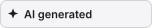
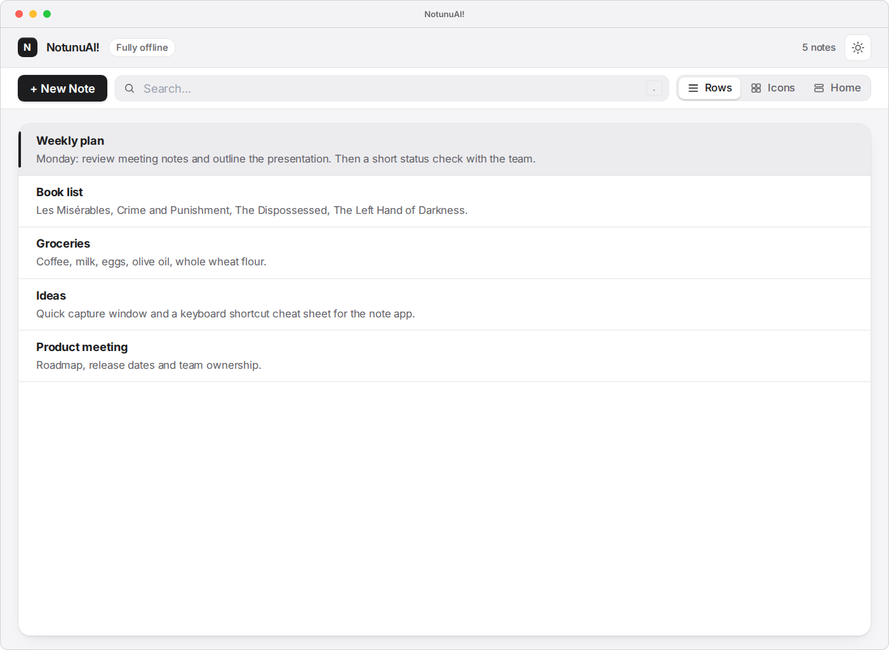

<h1 align="center">NotunuAl!</h1>

<p align="center">A fast, keyboard-first, entirely offline note-taking desktop app built with Tauri, React and TypeScript.</p>

<p align="center">
  
  
</p>

## Screenshots

<p align="center">
  
</p>

<p align="center">
  
</p>

### Regenerating the screenshots

The screenshots are **SVG files generated from the real application UI**: the script builds the production frontend, starts it, seeds demo notes through the same IndexedDB store the app uses, drives the actual React/TipTap screens with Playwright, and wraps the captured window in a macOS-style frame. No mock-ups, no fake DOM, no hand-drawn screens. One command regenerates them:

```bash
python3 scripts/make_screenshots.py
```

Output goes to `docs/img/`. Commit the SVGs: they stay sharp when zoomed and keep the README in sync with the real interface.

#### How it works

The screenshot pipeline has three seams:

**1. It serves the production build, not a mock-up**

```python
subprocess.run(["pnpm", "build:web"], cwd=ROOT, check=True)
server = subprocess.Popen(
    ["pnpm", "exec", "vite", "preview", "--host", "127.0.0.1", "--port", "4399", "--strictPort"],
    cwd=ROOT,
)
```

The preview serves exactly the same bundle that ships inside the app. A stale screenshot cannot survive a UI change: the build is regenerated on every run.

**2. It drives the real UI and the real data store**

```js
await page.evaluate(async (rows) => {
  const db = await new Promise((resolve, reject) => {
    const request = indexedDB.open('notunual');
    request.onsuccess = () => resolve(request.result);
    request.onerror = () => reject(request.error);
  });
  await new Promise((resolve, reject) => {
    const tx = db.transaction('notes', 'readwrite');
    for (const note of rows) tx.objectStore('notes').put(note);
    tx.oncomplete = () => resolve();
    tx.onerror = () => reject(tx.error);
  });
}, demoNotes);
```

Demo notes use the production `Note` shape and the production Dexie/IndexedDB schema. The list and editor screens are then reached by clicking the same accessible controls a user clicks.

**3. It wraps the real capture in a macOS window frame**

The frame (rounded corners, traffic lights, centered title) is drawn around the captured image in the SVG. The pixels inside are the app's own rendering. The script never edits a screenshot by hand.

#### Demo data: a realistic notebook

| Note | Purpose |
|---|---|
| Weekly plan | Selected row and editor screen |
| Book list | Normal list row |
| Groceries | Short body text |
| Ideas | Long body text |
| Product meeting | Another normal row |

The data is representative only. Notes never leave the device; the screenshot run makes no network requests beyond the local preview server.

#### Pitfalls

1. **Rebuild before capturing.** The script always runs `pnpm build:web`; do not point it at an old `dist/`.
2. **Keep the window size fixed.** The app renders at 1400 × 980 physical pixels (1000 × 700 CSS pixels at the app's 140% UI scale). Changing it changes the screenshot crop.
3. **Use fixed notes and content.** The demo data is deterministic so screenshot diffs stay meaningful.
4. **Never hand-edit an SVG.** Update the app or `scripts/make_screenshots.py` and regenerate.
5. **Keep the local server local.** The preview binds to `127.0.0.1` only.
6. **Commit SVGs, not PNGs.** The generated files are self-contained SVGs in `docs/img/`.

#### Badges

The license and AI-generated badges are small static SVGs in `docs/img/`. They are intentionally independent of external badge services.

## Features

- Offline-first notes stored in IndexedDB; no account, no telemetry, no network requests.
- Keyboard-first flow: `.` focuses search, `↑`/`↓` navigate, `Enter` opens, `Esc` goes back.
- `Ctrl+N` creates a note, `Ctrl+S` saves, `Ctrl+K` switches between light and dark themes.
- Three list modes: rows, icon grid, and the compact home layout.
- Rich text editor: bold, italic, text color, highlighter, five bundled fonts, and 12–32 px body size.
- Optional per-note date and title color.
- Export to XLSX, DOCX, PPTX, PDF, and TXT, including Turkish characters.
- Instant Turkish-aware search that stays under 100 ms with 5,000 notes.
- macOS-inspired graphite interface with light and dark themes.
- Linux / Wayland packaging: AppImage, RPM, and tarball.

## Installation

Build and run from source:

```bash
git clone https://github.com/colgecen/NotunuAl.git
cd NotunuAl
./notunual --install
```

`--install` is a one-time step that puts the `notunual` command in `~/.local/bin`, registers the desktop entry and icon, and lets you open the build menu from any folder:

```bash
notunual
```

Prebuilt binaries are available on the [Releases](https://github.com/colgecen/NotunuAl/releases) page.

## Usage

Run the app straight from source (press `Ctrl+C` to stop):

```bash
./notunual
```

Press `Ctrl+N` or click the new-note button to create a note, type the title, and write the body. The note is saved automatically after a short pause; `Ctrl+S` saves immediately. Press `.` to focus search, use `↑`/`↓` to move through results, `Enter` to open one, and `Esc` to return. `Ctrl+K` switches the theme, and the view-mode control above the list remembers your choice. All notes and settings stay in the app's local WebView data directory; no configuration file is required.

## License

This project is licensed under the [MIT](LICENSE) license.
