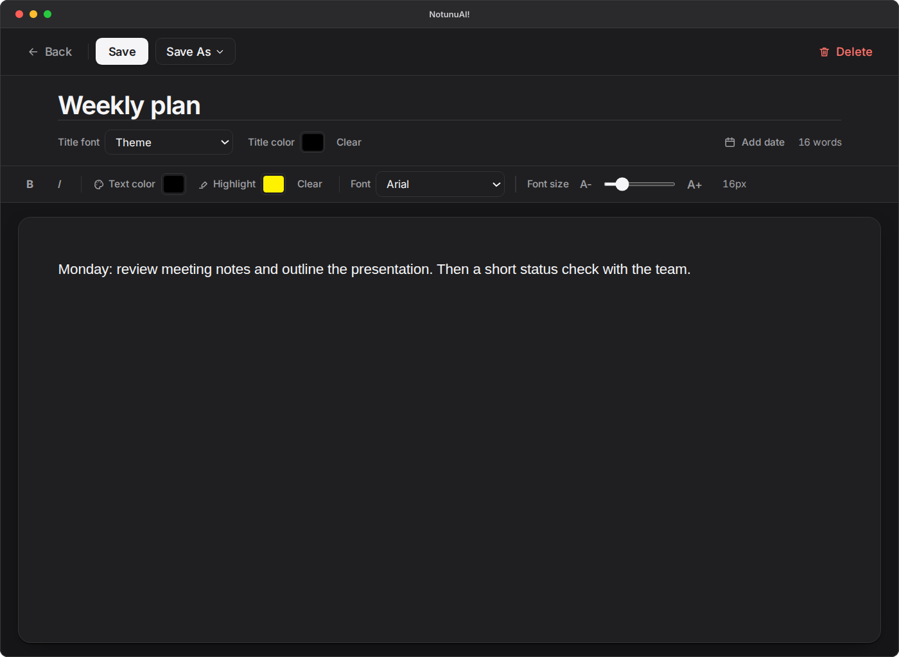

<h1 align="center">NotunuAl!</h1>

<p align="center">Offline, keyboard-first note-taking app for Linux with rich text.</p>

## Screenshots

<p align="center">
  
</p>

<p align="center">
  
</p>

## Features

- Stores notes entirely on the device with IndexedDB; no account, sync, or network requests.
- Instant Turkish-aware search across titles and bodies, under 100 ms with 5,000 notes.
- Keyboard shortcuts: `.` focuses search, `↑`/`↓` navigate, `Enter` opens, `Esc` returns, `Ctrl+N` creates, `Ctrl+S` saves, `Ctrl+K` switches themes.
- Rich text: bold, italic, text color, highlighter, five bundled fonts, and 12–32 px body size.
- Three list modes (rows, icons, home), plus optional title color, title font, and per-note date.
- Exports to XLSX, DOCX, PPTX, PDF, and TXT with Turkish characters preserved.
- Light and dark graphite themes with remembered settings.
- Linux and Wayland packaging as AppImage, RPM, and tar.gz.

## Installation

Build and run from source:

```bash
git clone https://github.com/colgecen/NotunuAl.git
cd NotunuAl
./notunual --install
```

`--install` is a one-time step that lets you type `notunual` (no `./`) to open the build menu:

```bash
notunual
```

Prebuilt binaries are available on the [Releases](https://github.com/colgecen/NotunuAl/releases) page.

## Usage

Run the app straight from source (press `Ctrl+C` to stop):

```bash
./notunual
```

Create a note with `Ctrl+N` or the new-note button, then type a title and body; the note saves automatically after a short pause, and `Ctrl+S` saves immediately. Press `.` to focus search, `↑`/`↓` to move through results, `Enter` to open one, and `Esc` to return. Theme and view-mode controls are in the top bar. Notes and settings are stored in the app's local WebView data directory.

## License

This project is licensed under the [MIT](LICENSE) license.
